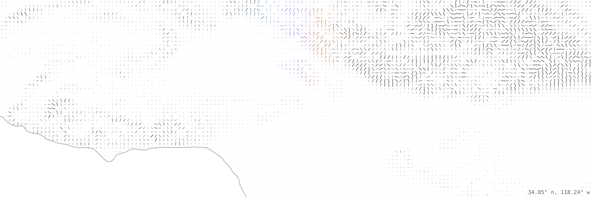

<picture>
  <source media="(prefers-color-scheme: dark)" srcset="./assets/la-dark.svg">
  
</picture>

## samuel kim

software engineer from los angeles, studying computer science at harvard.

working as an mts intern @ zendō labs building long-horizon tool-use rl environments for post-training frontier models. prev @ aws, amazon agi, contractsafe.

research @ harvard gse building rl environments and evals for llms tuned for classroom learning.

### stack

  
  
  
  
  
  
  
  

  
  
  
  
  
  

### selected work

[**pAIc-man**](https://github.com/mmattyV/pAIc-man) 
multiplayer pac-man on a distributed system, with grpc, raft consensus and state replication across server nodes. ai agents can play the ghosts or pac-man.

[**mintedlegacy**](https://moneymattersfinal.vercel.app) 
a digital exhibition on the history of coinage, built with react, typescript, shadcn/ui and supabase. won best project in harvard's history of art and architecture department.

[**miniml**](https://github.com/samuelhkim7/CS51FinalProject) 
an interpreter for a small subset of ocaml, written in ocaml.

[**dynamic memory allocator**](https://gitfront.io/r/heung77/EDJWYXyanMoy/cppdynamicmem/) 
a c++ allocator that catches invalid frees, double frees, boundary writes and leaks, and coalesces free blocks for reuse.

### elsewhere

[email](mailto:samulhkim7@gmail.com) · [linkedin](https://www.linkedin.com/in/samuel-jaehyung-kim/) · site coming soon
